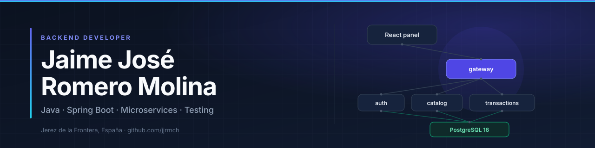
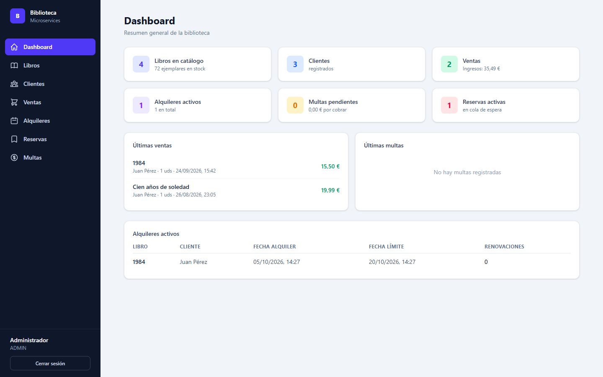
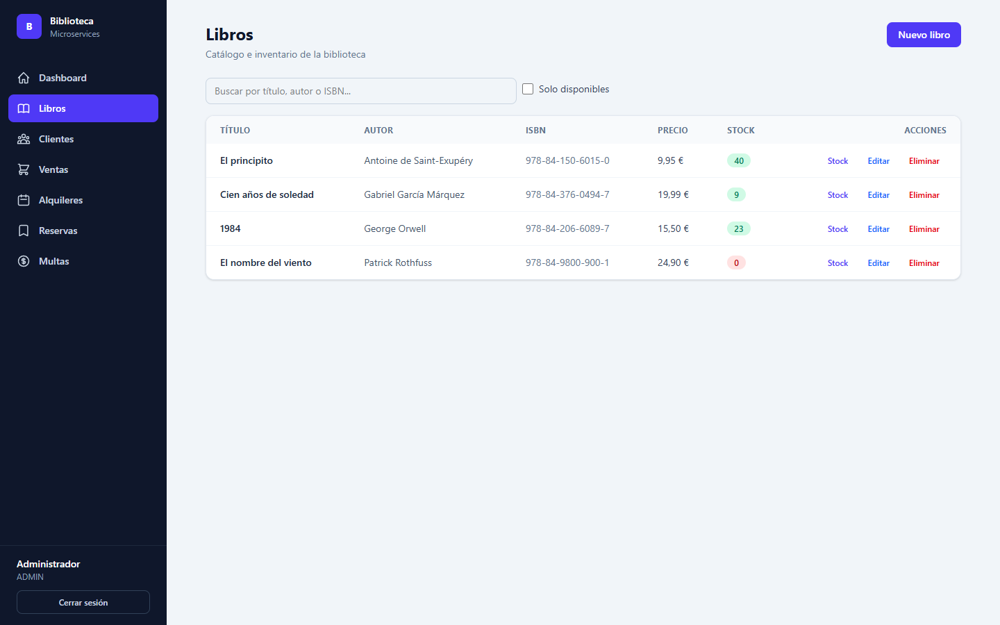
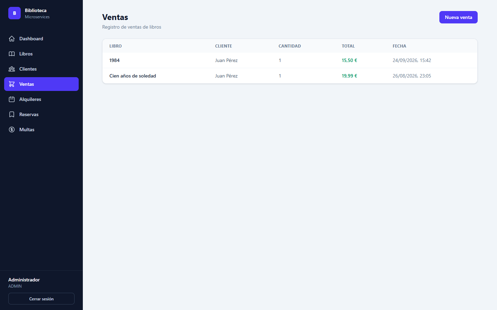
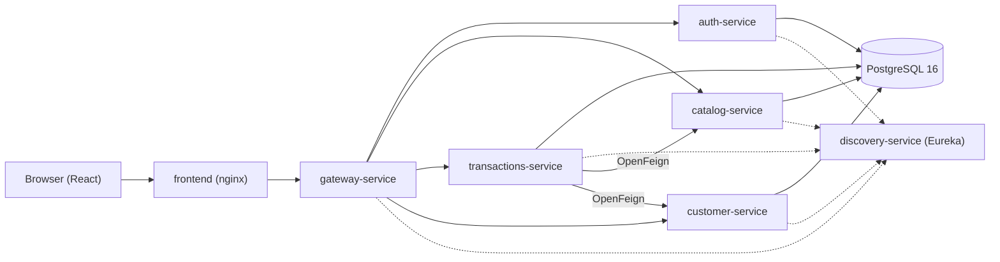

  
  
<strong>Backend Developer · Java + Spring</strong>

  
I build microservice systems end to end — and test them properly.

  
Jerez de la Frontera, España · Computer Science graduate (UHU) · Open to work

  
<a href="https://www.linkedin.com/in/jaime-jos%C3%A9-romero-molina-734258353/">LinkedIn</a> · <a href="mailto:jaimejoseromeromolina@gmail.com">Email</a> · <a href="https://github.com/jjrmch">GitHub</a>

  
<strong>Highlights:</strong> 8-repo Spring Cloud platform · 158 tests · CI green · TFG 9.90/10 with RAG + MCP

---

## About me

Computer Science graduate from the University of Huelva. My final degree project — a RAG/MCP chatbot ecosystem for the Erasmus+ office — scored **9.90/10**, was deployed on a university server and validated by the International Relations Office. I also completed the **TARTIS Recon-AI** program (Plexus Tech).

I build Java/Spring backends end to end: API design, security, integration tests, CI and Docker. I'm looking for my first role as a backend developer.

## Featured projects

### Biblioteca — Spring Cloud microservices platform

**8 repositories · 6 microservices · React frontend · PostgreSQL**

A library management system covering catalog and stock, sales, loans, reservations, fines, customers and role-based access — with stock that must never go negative. I built it as an 8-repo platform: six Spring Cloud services, a React panel and PostgreSQL, all started with Docker Compose.

| Catálogo | Ventas |
|---|---|
|  |  |

**What it demonstrates**

- **Security:** JWT issued by `auth-service`, validated independently by the gateway and every domain service, with role-based access (`ADMIN`, `BIBLIOTECARIO`, `CLIENTE`).
- **Service communication:** `transactions-service` orchestrates catalog and customers with OpenFeign, propagating the caller's token.
- **Testing:** 158 automated tests (JUnit 5, Mockito, Testcontainers), including a concurrency test that proves stock never goes negative.
- **Delivery:** CI green on all eight repositories, release `v1.0.0`, healthchecks and Docker Compose.

**Stack:** Java 21 · Spring Boot · Spring Cloud · Spring Security · OpenFeign · PostgreSQL · Testcontainers · Docker · React

[Main repository](https://github.com/jjrmch/biblioteca-deploy) · [Frontend](https://github.com/jjrmch/biblioteca-frontend)

<b>Architecture and repositories</b>

| Repository | Responsibility |
|---|---|
| [gateway-service](https://github.com/jjrmch/gateway-service) | API Gateway (Spring Cloud Gateway MVC): routing, JWT validation and Swagger aggregation |
| [auth-service](https://github.com/jjrmch/auth-service) | Registration, login and JWT issuance (Spring Security + BCrypt) |
| [catalog-service](https://github.com/jjrmch/catalog-service) | Books and stock with atomic updates; public reads, role-protected writes |
| [transactions-service](https://github.com/jjrmch/transactions-service) | Sales, loans, reservations and fines; orchestrates the other services with Feign |
| [customer-service](https://github.com/jjrmch/customer-service) | Customer CRUD and search, staff-only |
| [discovery-service](https://github.com/jjrmch/discovery-service) | Eureka service registry |
| [biblioteca-frontend](https://github.com/jjrmch/biblioteca-frontend) | React + Vite + Tailwind panel with login and role-based UI |
| [biblioteca-deploy](https://github.com/jjrmch/biblioteca-deploy) | Docker Compose stack, seed scripts and environment configuration |

### TFG — Erasmus RAG Chatbot

**9.90/10 · University of Huelva · RAG + MCP**

An AI chatbot ecosystem for the Erasmus+ office: a RAG assistant for students and an MCP agent for the administrative staff. It was deployed on a university server and validated by the International Relations Office.

- **RAG:** answers questions over the official Erasmus+ documentation using Qdrant and local embeddings.
- **MCP:** lets staff query the operational database in natural language — tickets, conversations and processed files.
- **Orchestration:** n8n workflows, PostgreSQL, Qdrant, Ollama and Docker Compose.

**Stack:** n8n · Qdrant · Ollama · PostgreSQL · Docker · RAG · MCP

[Repository](https://github.com/jjrmch/erasmus-rag-chatbot)

## Stack

| Area | Technologies |
|---|---|
| Backend | Java 21 · Spring Boot · Spring Cloud · Spring Security · JPA · OpenFeign · JUnit 5 · Mockito · Testcontainers |
| Data | PostgreSQL · SQL |
| Frontend | React · Vite · Tailwind CSS |
| Infrastructure | Docker Compose · GitHub Actions · CI/CD |
| AI & automation | n8n · Qdrant · Ollama · RAG · MCP |
| Languages | Spanish (native) · English (C1) |

## Let's talk

I'm looking for my first opportunity as a backend developer. If your team works with Java/Spring and values testing and clean delivery, I'd love to hear from you.

[LinkedIn](https://www.linkedin.com/in/jaime-jos%C3%A9-romero-molina-734258353/) · [Email](mailto:jaimejoseromeromolina@gmail.com) · [GitHub](https://github.com/jjrmch)

<b>🇪🇸 Leer en español</b>

**Backend Developer · Java + Spring**  
Construyo sistemas de microservicios de principio a fin y los testeo en serio.

**Ubicación:** Jerez de la Frontera, España · **Formación:** Graduado en Ingeniería Informática (UHU) · **Estado:** buscando mi primera oportunidad

Graduado en Ingeniería Informática por la Universidad de Huelva. Mi TFG —un ecosistema de chatbots RAG/MCP para la oficina Erasmus+— obtuvo un **9,90/10**, se desplegó en un servidor universitario y fue validado por la Oficina de Relaciones Internacionales. También completé el programa **TARTIS Recon-AI** (Plexus Tech).

**Proyectos destacados**

- **Biblioteca:** plataforma de microservicios Spring Cloud + React, 8 repositorios, 158 tests con Testcontainers, CI en GitHub Actions y Docker Compose.
- **TFG Erasmus RAG Chatbot:** RAG + MCP con n8n, Qdrant, PostgreSQL y Ollama; desplegado en un servidor universitario y validado por la ORI.

**Stack:** Java 21 · Spring Boot · Spring Cloud · Spring Security · PostgreSQL · Docker · GitHub Actions · React · n8n · Qdrant · Ollama  
**Idiomas:** Español nativo · Inglés C1

[LinkedIn](https://www.linkedin.com/in/jaime-jos%C3%A9-romero-molina-734258353/) · [Email](mailto:jaimejoseromeromolina@gmail.com) · [GitHub](https://github.com/jjrmch)

