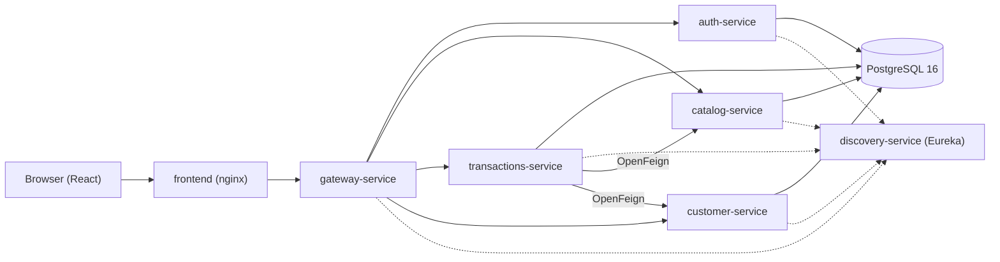

# jjrmch — Backend Developer (Java · Spring)

*Building microservice systems end to end, and testing them properly.*
*Construyo sistemas de microservicios de principio a fin y los testeo en serio.*

## Featured project — Library management platform

A library management system built as a **Spring Cloud microservices** platform with a **React** frontend. It covers the whole domain: catalog and stock, sales, loans, reservations, fines, customers and authentication. The complete stack runs locally with a single `docker compose up`.

### Architecture



### What it demonstrates

- **Stateless authentication with JWT**: `auth-service` issues the tokens; the gateway and the four domain services validate them independently (HS256, shared secret) and enforce role-based access (`ADMIN`, `BIBLIOTECARIO`, `CLIENTE`).
- **Inter-service token propagation**: `transactions-service` calls `catalog-service` and `customer-service` with OpenFeign, forwarding the caller's `Authorization` header so each service applies its own rules.
- **109 automated tests** across the backend: unit (JUnit 5 + Mockito) and integration (Spring Boot + MockMvc + **Testcontainers** with PostgreSQL), including a **concurrency test** proving stock never goes negative.
- **CI on GitHub Actions** for all eight repositories: build + tests on every push and pull request.
- **Docker Compose deployment**: PostgreSQL, Eureka, gateway, five services and the frontend, with healthchecks and environment-based configuration.

### Repositories

| Repository | Description |
|---|---|
| [gateway-service](https://github.com/jjrmch/gateway-service) | API Gateway (Spring Cloud Gateway MVC): routing, JWT validation and Swagger aggregation |
| [auth-service](https://github.com/jjrmch/auth-service) | Registration, login and JWT issuance (Spring Security + BCrypt) |
| [catalog-service](https://github.com/jjrmch/catalog-service) | Books and stock with atomic updates; public reads, role-protected writes |
| [transactions-service](https://github.com/jjrmch/transactions-service) | Sales, loans, reservations and fines; orchestrates the other services with Feign |
| [customer-service](https://github.com/jjrmch/customer-service) | Customer CRUD and search, staff-only |
| [discovery-service](https://github.com/jjrmch/discovery-service) | Eureka service registry |
| [biblioteca-frontend](https://github.com/jjrmch/biblioteca-frontend) | React + Vite + Tailwind panel with login and role-based UI |
| [biblioteca-deploy](https://github.com/jjrmch/biblioteca-deploy) | Docker Compose stack, seed scripts and environment configuration |

### Run it locally

```bash
git clone https://github.com/jjrmch/biblioteca-deploy
cd biblioteca-deploy
cp .env.example .env   # set your own JWT_SECRET and database credentials
docker compose up -d
# UI:     http://localhost:3000
# API:    http://localhost:8080
# Eureka: http://localhost:8761
```

The admin user is created on startup from `ADMIN_EMAIL` / `ADMIN_PASSWORD` in `.env`.

## En español

Desarrollador backend Java/Spring. Este perfil reúne un sistema de gestión de biblioteca construido con microservicios (Spring Cloud) y frontend en React: seguridad JWT validada en cada servicio, propagación del token entre microservicios con Feign, 109 tests con Testcontainers (incluido uno de concurrencia sobre el stock) y CI con GitHub Actions en los 8 repositorios. Los READMEs de cada repo están en español e incluyen instrucciones para levantar todo con Docker Compose.
